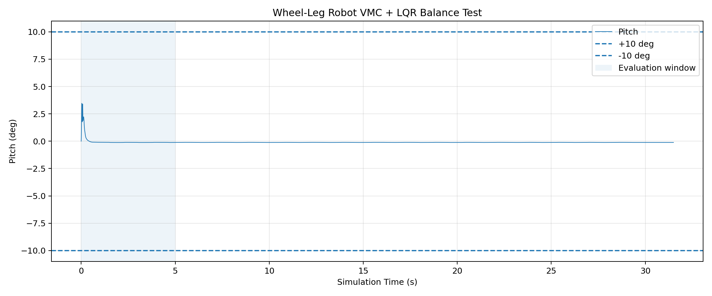

# Wheel-Leg Robot Controller

基于 ROS2 Humble 的轮腿机器人 VMC + LQR 平衡控制器。

## 1. 项目简介

本项目将机器人仿真与控制器拆分为独立 ROS2 节点。

- `wheel_leg_sim`：负责 MuJoCo 物理仿真、传感器状态发布和执行器指令接收。
- `wheel_leg_controller`：负责读取机器人状态、计算 VMC + LQR 控制指令并发布执行器力矩。

控制器不直接调用 MuJoCo API，仿真与控制通过 ROS2 Topic 通信。

## 2. 系统架构

```text
                 /imu
wheel_leg_sim ------------------+
                                |
             /joint_states      v
wheel_leg_sim ------------> wheel_leg_controller
                                |
             /cmd_vel           |
外部速度指令 -------------------->|
                                |
                                | /actuator_cmd
                                v
                          wheel_leg_sim
                                |
                                v
                         MuJoCo 仿真
```

## 3. ROS2 通信接口

| Topic | 消息类型 | 方向 |
|---|---|---|
| `/imu` | `sensor_msgs/msg/Imu` | 仿真器 → 控制器 |
| `/joint_states` | `sensor_msgs/msg/JointState` | 仿真器 → 控制器 |
| `/cmd_vel` | `geometry_msgs/msg/Twist` | 外部 → 控制器 |
| `/actuator_cmd` | `rm_msgs/msg/WheelLegCmd` | 控制器 → 仿真器 |

`/actuator_cmd` 包含六路执行器力矩：

1. `right_phi1`
2. `right_phi4`
3. `left_phi1`
4. `left_phi4`
5. `right_wheel`
6. `left_wheel`

## 4. 控制算法

### 4.1 VMC

使用虚拟模型控制方法，将期望腿部支撑力和虚拟关节力矩映射为实际关节力矩。

相关代码：

- `wheel_leg_controller/vmc_cal.py`
- `wheel_leg_controller/roll_leg_control.py`

### 4.2 LQR

采用线性二次型调节器进行机器人站立平衡控制。

控制器根据机器人状态计算控制输出，并通过 VMC 与执行器力矩映射作用于机器人。

LQR 增益根据腿长动态计算：

```python
K = lqr.calc_k_matrix_from_poly(links.L_0)
```

相关代码：

- `wheel_leg_controller/lqr_update.py`
- `wheel_leg_controller/wheel_leg_controller.py`

### 4.3 控制参数

| 参数 | 验收运行值 | 说明 |
|---|---|---|
| `enable_control` | `true` | 启用控制 |
| `target_length` | `0.10` | 目标腿长，单位 m |
| `pitch_sign` | `-1.0` | Pitch 符号修正 |
| `gyro_pitch_sign` | `-1.0` | Pitch 角速度符号修正 |

## 5. 环境

- Ubuntu 22.04
- ROS2 Humble
- Python
- MuJoCo
- Conda 环境：`rm_ros2`

## 6. 编译

进入 ROS2 工作空间：

```bash
cd ~/venom_cpp_basics/training/02-ros2-wheelleg/Tutorial/ros2_ws
conda activate rm_ros2
source /opt/ros/humble/setup.bash

colcon build --packages-select wheel_leg_controller
source install/setup.bash
```

## 7. 运行

终端 A：启动仿真器。

```bash
conda activate rm_ros2
source /opt/ros/humble/setup.bash
cd ~/venom_cpp_basics/training/02-ros2-wheelleg/Tutorial/ros2_ws
source install/setup.bash

ros2 run wheel_leg_sim wheel_leg_sim
```

终端 B：启动控制器。

```bash
conda activate rm_ros2
source /opt/ros/humble/setup.bash
cd ~/venom_cpp_basics/training/02-ros2-wheelleg/Tutorial/ros2_ws
source install/setup.bash

ros2 run wheel_leg_controller wheel_leg_controller \
  --ros-args \
  -p enable_control:=true \
  -p target_length:=0.10 \
  -p pitch_sign:=-1.0 \
  -p gyro_pitch_sign:=-1.0
```

## 8. 阶段 4：平衡验收

使用 ROS2 bag 录制：

```bash
ros2 bag record -o balance_stage4 \
  /imu /joint_states /actuator_cmd
```

从录制的 IMU 四元数计算 Pitch，得到：

| 指标 | 实测结果 |
|---|---|
| 有效 IMU 样本 | 46671 |
| 记录的仿真时长 | 31.498 s |
| 全程最大绝对 Pitch | 3.4632° |
| 全程平均绝对 Pitch | 0.1196° |
| 前 5 秒验收窗口 | 5.0016 s |
| 前 5 秒最大绝对 Pitch | 3.4632° |
| 验收结果 | PASS |

根据录制样本，机器人满足连续平衡至少 5 秒、绝对 Pitch 小于 10° 的要求。

### Pitch 曲线



### 验收报告

见 [balance_report.txt](results/balance_report.txt)。

### ROS bag

录制文件保存在本地：

`~/wheel_leg_results/balance_stage4/`

